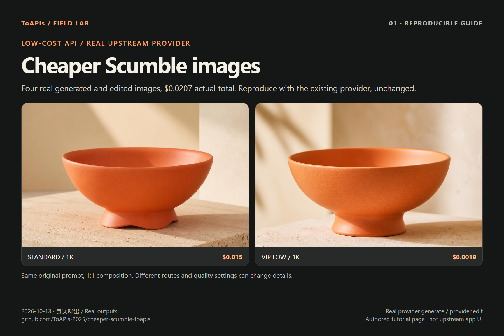

# Cheaper Scumble images · ToAPIs low-cost API

<!-- TOAPIS-MODEL-COST-UPDATE-20261016 -->
## Tested model types, presets and costs

Updated October 16, 2026. These are tested historical presets/prices; this addition does not relabel the original batch below.

| Model (API ID) | Type | Tested preset | Unit quote | Confirmed unit charge | Count |
|---|---|---|---:|---:|---:|
| gpt-image-2(VIP) (`gpt-image-2-vip`) | Image | low / 1K / n=1 | $0.0019/image | $0.0019 | 3 |
| gpt-image-2 | Image | 1K / n=1 | $0.015/image | $0.015 | 1 |

Confirmed original image/video example subtotal: **$0.0207**.

Existing ToAPIs provider generation/reference edits validated; full canvas, masking and video are unvalidated.

gpt-image-2(VIP), **from $0.0019/image**; the tested low/1K preset here is **$0.0019/image**. Different models, qualities and resolutions do not imply equivalent results.
<!-- /TOAPIS-MODEL-COST-UPDATE-20261016 -->

[English](README.md) · [简体中文](README_zh-CN.md) · [Pricing](PRICING.md) · [Actual charges](COSTS.md) · [Real outputs](GALLERY.md)

Generate and reference-edit through Scumble’s existing ToAPIs provider: **4 real PNGs**, one standard/VIP pair plus dark-studio and interior variations. Tested 2026-10-13; actual charge **4.14 credits=$0.0207**. Calls execute the real upstream module, not simulated API results.



“Cheaper” compares VIP low / 1K **$0.0019/image** with standard / 1K **$0.015/image**, approximately 87.3% lower quoted rate here. Routes and quality settings differ; equivalent quality is not promised. [Price table](PRICING.md) · [Charges and one unknown submission](COSTS.md).

## Reproduce

Node 20+ (tested 24.19.0) and Git. This is an independent community tutorial, not an official Scumble edition or confirmation of a partnership. Install the Electron product using upstream instructions. The commands below validate the provider module without launching the canvas.

```bash
git clone https://github.com/ToAPIs-2025/cheaper-scumble-toapis.git
git clone https://github.com/DenRakEiw/scumble.git scumble-upstream
git -C scumble-upstream checkout 0d0be6b3e41f00e8621af14fe11597eaf258501f
cd cheaper-scumble-toapis
cp .env.example .env
# Fill TOAPIS_API_KEY privately. Windows PowerShell: Copy-Item .env.example .env
node run_cases.cjs --upstream ../scumble-upstream
node ../scumble-upstream/tools/toapis_test.js
node run_cases.cjs --upstream ../scumble-upstream --key-file .env --live --case vip-low-coral-bowl
node run_cases.cjs --upstream ../scumble-upstream --key-file .env --live
```

Default mode makes no API call. The first VIP case generates one image; all four cases cost $0.0207 in this run. Dark/interior edits depend on vip-low-coral-bowl. Completed evidence is reused. An existing receipt without a completed result stops execution; query the original task instead of paying for another submission. Use Node’s system CA/proxy configuration when needed; do not disable TLS checks.

## Integration details and reuse improvements

Pinned SHA: `0d0be6b3e41f00e8621af14fe11597eaf258501f`. No change to electron/main/providers/toapis.js is required. The wrapper calls its actual generate(req,ctx) and edit(req,ctx) functions. The original recipe is recipes/gpt_image_2.json; multiple channels have different model/parameter behavior. Setting a Base URL alone does not validate every model.

1. `ctx.key` and **`ctx.base`** (origin, e.g. `https://toapis.cn`); not `ctx.settings`.
2. Standard → `gpt-image-2`, omit quality. VIP → `gpt-image-2-vip`, quality=`low`, resolution=`1k`, n=1, size=`1:1`.
3. References → `POST /v1/uploads/images`; `reference_images` uses the uploaded URL.
4. Generation → `POST /v1/images/generations`; task query → `GET /v1/images/generations/{id}`; download results without Key.
5. Wrapper adds durable submission receipts, one generation POST per case, 8-second minimum polling, original-byte output and SHA-256 evidence.

The two edit calls are whole-image reference-guided changes. VIP does not use a server-side alpha mask here; this does not validate masked inpainting. Electron canvas, selection stitching, layers, PSD/ORA export and video remain untested. Passing upstream mock tests does not establish live support for those features.

## More cases: one product, three scenes

The original input is a fictional coral-orange ceramic bowl, with no logos or lettering. Generate the cream studio image, upload the resulting PNG and request dark-studio and sunlit-interior variations. Color and silhouette preservation are prompt goals; details can change, so product consistency is not guaranteed.

[Original prompts](cases/briefs.json) · [Four original PNGs](GALLERY.md) · [Task IDs / pixels / hashes](EVIDENCE.md)

## Charges and author attribution

The four task charges confirmed from the dashboard total $0.0207; API billing remains absent. A separate earlier input submitted with an incorrect ctx configuration returned no task ID. Its acceptance/cost are unknown; it was not retried and is excluded from the confirmed total. Preserve the original author referral URL https://toapis.com/login?aff=vfR1. Ownership and payout arrangements are unverified; this tutorial does not replace or claim that code.

[DenRakEiw/scumble](https://github.com/DenRakEiw/scumble) · [Pinned source](https://github.com/DenRakEiw/scumble/tree/0d0be6b3e41f00e8621af14fe11597eaf258501f) · [GPL-3.0](LICENSE).

[Explore ToAPIs low-cost image API](https://go2v.toapis.com/1013_scumble_cheaper_gh_en) · [X screenshot guide](SCREENSHOT_GUIDE.md)
