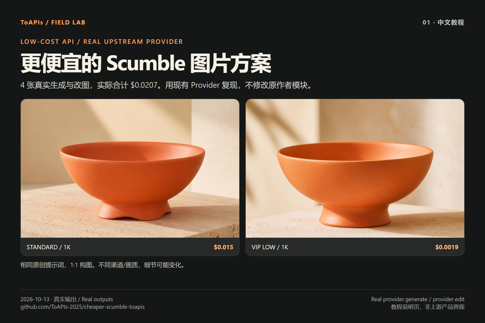

# 更便宜的 Scumble 图片方案 · ToAPIs 低价 API

[English](README.md) · [简体中文](README_zh-CN.md) · [Pricing](PRICING.md) · [Actual charges](COSTS.md) · [Real outputs](GALLERY.md)

通过 Scumble 已有 ToAPIs Provider 生成与参考改图：**4 张真实 PNG**，一组标准/VIP 对比，加暗色棚拍与室内场景。2026-10-13 实测消费 **4.14 积分=$0.0207**。使用上游真实模块，不用模拟 API 结果。



“更便宜”是 VIP low / 1K **$0.0019/张** 对比 standard / 1K **$0.015/张**，本次报价低约 87.3%。渠道与画质不同，不保证同等效果。[完整价表](PRICING_zh-CN.md) · [实际消费与一次未知提交](COSTS_zh-CN.md)。

## 复现

Node 20+（本次 24.19.0）、Git。此仓库是独立社区教程，不是 Scumble 官方分支或已确定的商务合作。原 Electron 产品按上游说明安装。以下验收 Provider 模块，不启动画布。

```bash
git clone https://github.com/ToAPIs-2025/cheaper-scumble-toapis.git
git clone https://github.com/DenRakEiw/scumble.git scumble-upstream
git -C scumble-upstream checkout 0d0be6b3e41f00e8621af14fe11597eaf258501f
cd cheaper-scumble-toapis
cp .env.example .env
# Fill TOAPIS_API_KEY privately. Windows PowerShell: Copy-Item .env.example .env
node run_cases.cjs --upstream ../scumble-upstream
node ../scumble-upstream/tools/toapis_test.js
node run_cases.cjs --upstream ../scumble-upstream --key-file .env --live --case vip-low-coral-bowl
node run_cases.cjs --upstream ../scumble-upstream --key-file .env --live
```

默认不调用 API。VIP 首例只生成一张；全部四例本次消费 $0.0207。暗色和室内参考改图依赖 vip-low-coral-bowl。已有 evidence 复用，已有 receipt 但无成功结果则停止，先按 task id 查询，不会自动再次付费提交。需要代理时使用 Node 的系统 CA/代理配置，不关闭 TLS 验证。

## 接入要点与复用优化

固定 SHA `0d0be6b3e41f00e8621af14fe11597eaf258501f`。无须修改原 `electron/main/providers/toapis.js`；wrapper 直接调用 `generate(req, ctx)` 和 `edit(req, ctx)`。原 recipe 在 `recipes/gpt_image_2.json`，预设有多个通道，不能只填 Base URL 就判定所有模型兼容。

1. `ctx.key` and **`ctx.base`** (origin, e.g. `https://toapis.cn`); not `ctx.settings`.
2. Standard → `gpt-image-2`, omit quality. VIP → `gpt-image-2-vip`, quality=`low`, resolution=`1k`, n=1, size=`1:1`.
3. References → `POST /v1/uploads/images`; `reference_images` uses the uploaded URL.
4. Generation → `POST /v1/images/generations`; task query → `GET /v1/images/generations/{id}`; download results without Key.
5. Wrapper adds durable submission receipts, one generation POST per case, 8-second minimum polling, original-byte output and SHA-256 evidence.

两次 `edit` 为整张参考图的指令改图。VIP 不使用服务端 alpha mask，不能说已验证蒙版局部修复。Electron 画布、选区回填、图层、PSD/ORA 导出和视频均未验收；上游 mock 测试通过也不等于这些实测。

## 多案例：一件产品，三种场景

输入为原创珊瑚橙陶瓷碗、无品牌/文字。生成白色棚拍，再把该真实 PNG 上传，分别改成深色棚拍和日照室内。保持色彩和轮廓是提示词目标，实际细节可能改变；不要用作商品一致性的保证。

[Original prompts](cases/briefs.json) · [Four original PNGs](GALLERY.md) · [Task IDs / pixels / hashes](EVIDENCE.md)

## 费用与原作者归因

后台截图确认的四个任务合计 $0.0207，API 的 billing 仍为空。另一个早期不同输入的提交在错误的 ctx 配置下没有返回任务 ID；其受理和消费未知，未重试、不计入已确认合计。保留原作者 `https://toapis.com/login?aff=vfR1` 推荐入口，归属/分成尚未核实，本教程不替换或宣称拥有此推荐码。

[DenRakEiw/scumble](https://github.com/DenRakEiw/scumble) · [Pinned source](https://github.com/DenRakEiw/scumble/tree/0d0be6b3e41f00e8621af14fe11597eaf258501f) · [GPL-3.0](LICENSE).

[查看 ToAPIs 低价图片 API](https://go2v.toapis.com/1013_scumble_cheaper_gh_cn) · [X screenshot guide](SCREENSHOT_GUIDE_zh-CN.md)
